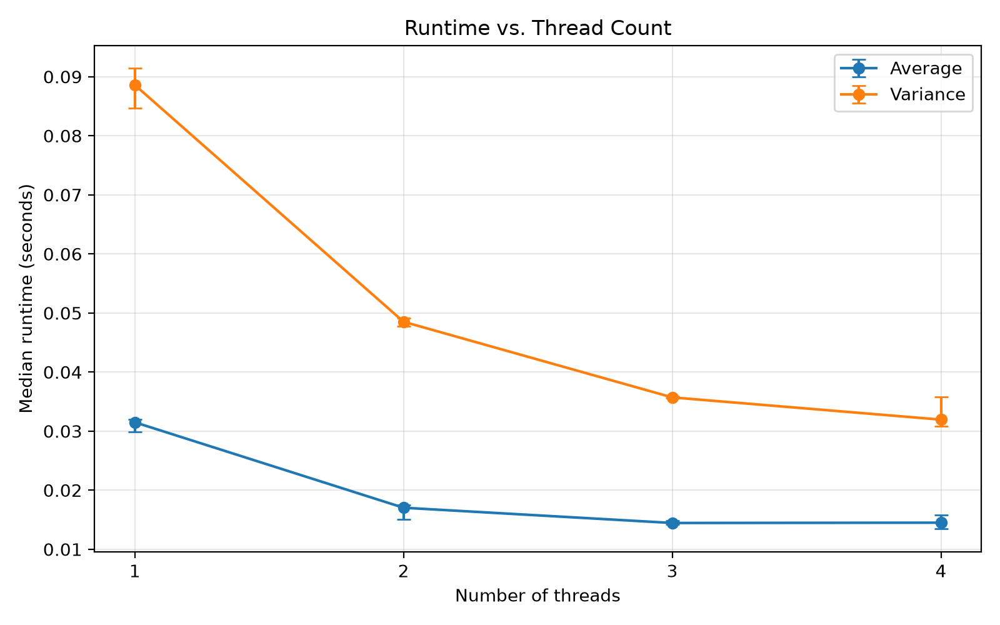
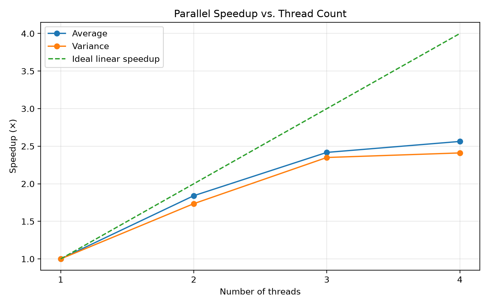
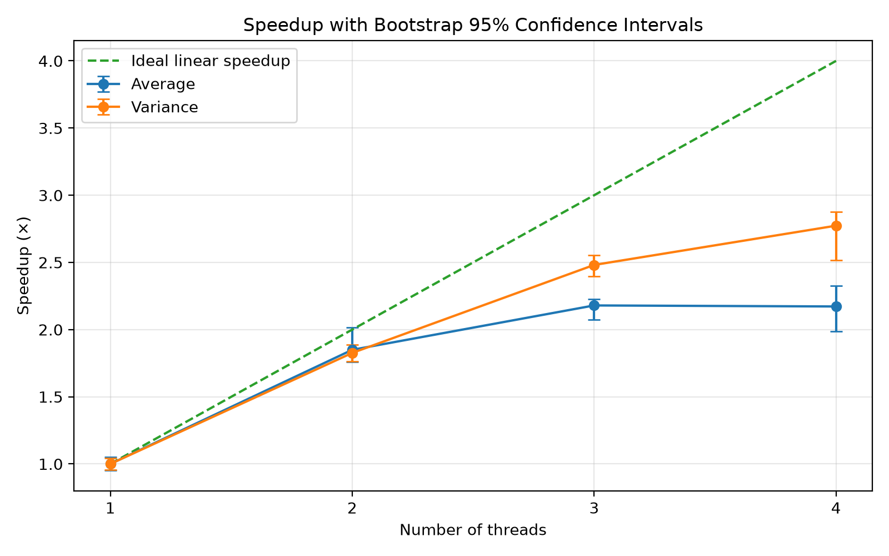
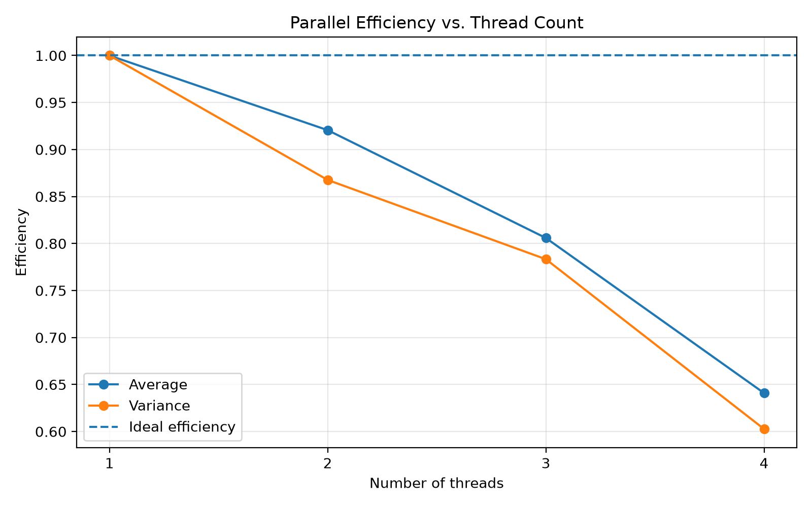
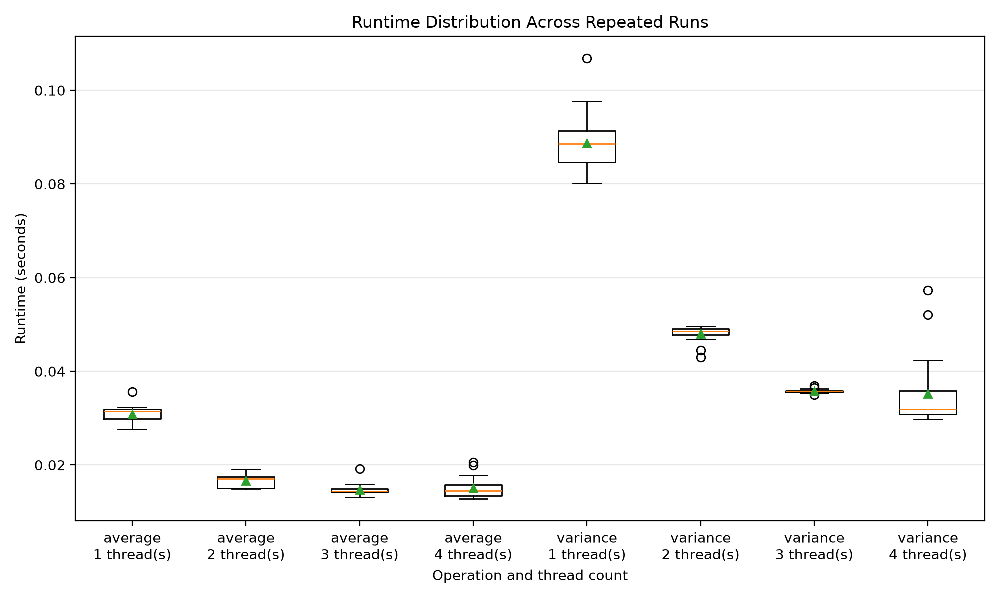

# multithreaded-statistics

A simple C project that calculates the **average** and **variance** of a large dataset of randomly generated integers using multithreading on Windows, and measures how much faster it gets with more threads.

## Features

- **Average:** Calculates the mean of the generated values using multiple threads.
- **Variance:** Measures how much the values differ from the mean, also multithreaded.
- **Benchmarking:** Measures runtime, speedup and parallel efficiency for 1 to 4 threads, with plots.

## How It Works

1. Generate 100,000,000 random integers between 0 and 99.
2. Divide the dataset into chunks based on the selected number of threads.
3. Let each thread process its assigned chunk.
4. Combine the partial results to calculate the final statistic.

## Compilation

Compile the programs using GCC:

```bash
gcc src/main.c -o src/main.exe
gcc src/benchmark.c -o src/benchmark.exe
```

## Usage

Run the interactive program:

```bash
src/main.exe
```

Choose an operation from the menu:

1. Calculate the average.
2. Calculate the variance.

Then choose the number of threads to use, from 1 to 4.

### Running the benchmark

```bash
pip install -r requirements.txt
python scripts/run_benchmark.py
python scripts/generate_plots.py
```

Raw and summarized results are saved in `results/`, and the charts in `plots/`.

## Results

All benchmarks use 100,000,000 numbers and repeated runs per thread count.

### Runtime

<p align="center">
  
</p>
<p align="center"><em>Median runtime for average and variance with 1 to 4 threads.</em></p>

Runtime drops as threads are added. Variance takes longer than average because it does more work per number. Going from 1 to 2 threads cuts the time almost in half, but after that the gains get small (especially for average).

### Speedup

<p align="center">
  
</p>
<p align="center"><em>Speedup compared to 1 thread, with the ideal linear speedup as reference.</em></p>

Speedup is `time with 1 thread / time with N threads`. The dashed line is the ideal case where 4 threads are 4x faster. In practice, variance reaches about **2.8x** with 4 threads, while average stops at about **2.2x**.

### Speedup with Confidence Intervals

<p align="center">
  
</p>
<p align="center"><em>Same speedup, with bootstrap 95% confidence intervals as error bars.</em></p>

The error bars show how reliable each measurement is. Short bars mean the result is stable across runs. The wider bars at 4 threads show more variation there, so the exact value is less certain.

### Parallel Efficiency

<p align="center">
  
</p>
<p align="center"><em>Parallel efficiency (speedup divided by number of threads).</em></p>

Efficiency tells us how well each thread is being used. 1.0 means perfect scaling. With 4 threads, efficiency falls to about **0.69** for variance and **0.54** for average, meaning extra threads spend more time waiting or on overhead.

### Runtime Distribution

<p align="center">
  
</p>
<p align="center"><em>Box plots of runtime across repeated runs (green triangle = mean, orange line = median).</em></p>

This shows how much runtimes vary between runs. Most boxes are narrow, so results are consistent. The circles are outliers, usually single slower runs caused by other processes on the system. The 4-thread variance case is the most spread out.

## Conclusion

Multithreading clearly speeds up both calculations, but not linearly. Average is a very simple operation, so it quickly becomes limited by memory speed and thread overhead rather than computing power. Variance does more computation per value, so it benefits more from extra threads.

## Project Structure

```
📁 
├── 📁 plots
├── 📁 results
├── 📁 scripts
├── 📁 src
├── ⚖️ LICENSE
├── 📘 README.md
└── 📝 requirements.txt
```
> Generated using [Tree Printer](https://github.com/AmirmasoudCS/Tree-Printer.git)

## License

See [Here](./LICENSE).